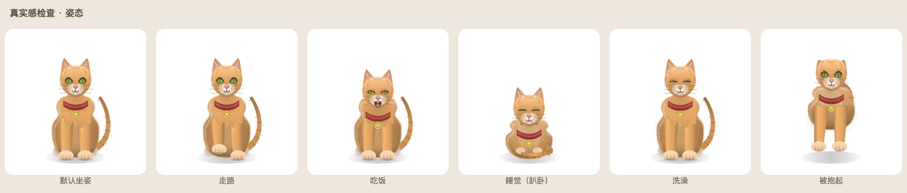

# 桌面宠物 · 团子

一只住在 Windows 桌面上的小猫。

会呼吸、眨眼、自己在屏幕上溜达；可以摸头、喂饭、洗澡、哄睡；会跟你聊天，也会一天天长大（蛋 → 幼崽 → 少年 → 成年）。



---

## 它能做什么

| 能力 | 说明 |
| --- | --- |
| 陪伴 | 透明无边框窗口，始终浮在桌面上，可以拖到任何位置，也会自己慢慢走动 |
| 互动 | 左键摸头、按住拖动搬家、双击打开聊天、右键打开功能菜单 |
| 养成 | 饱食度 / 精力 / 清洁度 / 心情四项属性随时间变化，照顾得好就长得快 |
| 成长 | 等级、经验、亲密度、四个成长阶段、八个成就 |
| 对话 | 内置 200+ 条台词的本地词库，**不联网也能聊**；填了 API Key 后可用大模型 |
| 记忆 | 自动存档，关掉再开继续养；离线期间也会慢慢变饿（速度减半，最多补 10 小时） |
| 托盘 | 关闭窗口不算退出，可以从系统托盘随时叫回来 |

## 在 Windows 上运行

### 方式一：直接运行（电脑上要先装 Python）

1. 安装 **Python 3.10 或更高版本**：<https://www.python.org/downloads/>
   安装第一步一定要勾选 **Add python.exe to PATH**。
2. 双击 **`安装依赖.bat`**，等它跑完（第一次约 100MB，只装一次）。
3. 双击 **`启动.bat`**，宠物就出现在屏幕右下角了。

### 方式二：打包成 exe（给没装 Python 的电脑）

双击 **`打包exe.bat`**，几分钟后在 `dist\DesktopPet.exe` 得到单文件程序。
把这个 exe 拷到任何 Windows 电脑上双击即可，不需要装 Python。

> PyInstaller 不能跨系统打包。在 Mac 上想拿 exe，用下面的 GitHub Actions。

## 在 macOS 上运行

```bash
python3 -m venv .venv
./.venv/bin/pip install -r requirements.txt
./.venv/bin/python main.py
```

打包成 .app：

```bash
./.venv/bin/pip install pyinstaller pillow
./.venv/bin/python tools/make_icon.py
./.venv/bin/python -m PyInstaller --noconfirm --windowed --name DesktopPet \
  --icon assets/DesktopPet.icns --osx-bundle-identifier com.lindong.desktoppet main.py
open dist/DesktopPet.app
```

## 自动出包（GitHub Actions）

`.github/workflows/build.yml` 会在每次 push 时自动构建两个平台的产物：

| 平台 | 产物 | 拿法 |
| --- | --- | --- |
| macOS | `DesktopPet.app`（zip） | Actions → 对应 run → Artifacts |
| Windows | `DesktopPet.exe`（单文件） | 同上 |

也可以本地触发：仓库页面 → Actions → build → Run workflow。
打 tag（如 `v1.0.0`）同样会触发。

> Mac 和 Windows 的包必须在对应系统上构建，这就是用 CI 的原因。

## 怎么玩

| 操作 | 效果 |
| --- | --- |
| 左键单击 | 摸摸头，心情 +，亲密度 + |
| 按住拖动 | 把它搬到别的地方 |
| 双击 | 打开聊天面板 |
| 右键 | 菜单：喂食 / 玩耍 / 洗澡 / 睡觉 / 聊天 / 状态 / 设置 |
| 托盘图标 | 显示或隐藏、聊天、状态、设置、退出 |

**照顾它**：饿了右键喂点东西（小鱼干、牛奶、蛋糕、苹果、布丁）；脏了洗澡；精力低了让它睡一觉；心情差了陪它玩一会儿或者聊两句。

**关于成长**：刚开始是一颗蛋，连续摸三次就会破壳。等级越高，样子会变（幼崽戴围兜、少年戴铃铛项圈、成年戴小皇冠），体型也会略微变大。

**它不会死**：属性最低只会让它没精神、闹脾气，不会消失，可以放心让孩子养。

## 接入大模型（可选）

设置 → 对话（可选）→ 勾选「启用大模型对话」→ 选「服务商」，地址和模型会自动填好，你只需要补一个密钥。

| 服务商 | 免费情况 | 要不要注册 |
| --- | --- | --- |
| **智谱 GLM**（首选） | `glm-4-flash` / `glm-4.7-flash` 官方标注免费（输入输出均 0 元） | 要，注册 + 实名，约 2 分钟 |
| **魔搭 ModelScope** | 每人每天约 2000 次免费调用 | 要，绑定阿里云账号 + 实名 |
| 免注册试用（Pollinations） | 免费，但**每 45 秒只能回一条** | 不用，勾上就能试 |
| 本地 Ollama | 完全免费、不限量、不联网 | 不用，但要先装模型（约 2GB） |
| 硅基流动 / 通义百炼 | 注册送额度，部分小模型免费 | 要 |
| DeepSeek | 没有免费额度，但便宜到可以忽略 | 要 |

**推荐流程（智谱）**：

1. 选「智谱 GLM」，点 **获取免费 Key**，浏览器会打开 API Keys 页面
2. 注册（手机号）→ 完成实名认证 → 创建 API Key → 复制
3. 粘贴到「密钥」里，点 **测试连接**，看到「连接成功」就保存

模型名报 404 的话，点 **刷新模型** 会自动拉取你账号能用的模型列表，重选一个即可。

**智谱各模型实测对比**（同一密钥、同样的宠物对话，2026-11 实测）：

| 模型 | 输入/输出价 | 延迟 | 结论 |
| --- | --- | --- | --- |
| `glm-4.7-flash` | 0 元（免费） | 关闭思考后 **0.7–3 秒** | **默认就用这个**，30B 级、够聪明 |
| `glm-4-flash` | 0 元（免费） | 1–8 秒 | 前一个排队时自动顶上，两个都免费 |
| `glm-5.3-flash` | 0.8 / 2.8 元每百万 token | 5–14 秒 | 答得更好，**但要花钱**，不适合日常闲聊 |
| `glm-4.6v-flash` | 0 元（免费，视觉） | 高峰常 429 | 只在要看图时用 |

三个实现细节：

- **自动关思考**：`glm-4.7-flash` 开着思考要 20–30 秒，关掉只要 1 秒。程序会主动发 `thinking: disabled`；遇到 `glm-5.x` 这种"始终思考"的型号（报错 1210）再自动退回开启。
- **免费模型互相顶替**：`glm-4.7-flash` 排队时自动换 `glm-4-flash`，两个都挤不进去就快速失败、退回本地词库，不会让你干等。
- **不会等 30 秒**：早先版本在 429 后会切到"开启思考"重试，实测要 35 秒，已改成快速失败。

注意：`glm-5` 系列都是**付费**的。"GLM 免费"指的是 `flash` 那几档，别混。

- 只要接口兼容 OpenAI 的 `/chat/completions` 格式就能用，选「自定义」填自己的地址。
- 不填也完全能玩，只是对话走本地词库。
- 开启后只会把「你打的字 + 宠物当前状态」发送到你填的那个地址，没有别的联网行为。

> **不要指望用自己的 WorkBuddy / ChatGPT 账号登录**：它们都没有对外开放「个人账号 → 第三方程序」的 OpenAI 兼容接口，本程序也没有登录功能。只能走上面这些 API Key 的方式。

## 数据放在哪

| 文件 | 位置 |
| --- | --- |
| 存档 | `%APPDATA%\DesktopPet\save.json` |
| 设置 | `%APPDATA%\DesktopPet\settings.json` |

想让它从头再来：把 `%APPDATA%\DesktopPet` 文件夹删掉即可。

## 想改造它

| 想改什么 | 改哪里 |
| --- | --- |
| 台词、回复逻辑 | `pet/dialogue.py` 里的 `INTENTS`（关键词 → 台词） |
| 加食物 | `pet/config.py` 里的 `FOODS`（`icon` 可复用现有图标名） |
| 配色 | `pet/config.py` 里的 `PALETTES` |
| 长啥样 | `pet/painter.py` 里的 `_draw_cat`、`_draw_eye`、`_draw_accessory` |
| 饿得多快 | 设置里的「养成节奏」，或 `pet/state.py` 里的 `DECAY` |
| 面板样式 | 各 `*_panel.py` 底部的 `setStyleSheet` |

## 目录结构

```
DesktopPet/
├─ main.py                 启动入口（单实例、离线补算）
├─ requirements.txt
├─ 安装依赖.bat            第一次运行前双击
├─ 启动.bat                以后每次双击这个
├─ 打包exe.bat             生成单文件 exe
├─ pet/
│  ├─ config.py            路径、配色、食物、成就、默认设置
│  ├─ state.py             属性衰减、互动、成长、存档（纯逻辑，不依赖 Qt）
│  ├─ dialogue.py          本地对话引擎 + 大模型提示词
│  ├─ llm.py               OpenAI 兼容接口（urllib，后台线程）
│  ├─ painter.py           宠物矢量绘制（无图片素材）
│  ├─ effects.py           爱心 / Zzz / 星星 / 泡泡粒子
│  ├─ bubble.py            头顶对话气泡
│  ├─ pet_window.py        主窗口：动画循环、拖拽、菜单、托盘
│  ├─ chat_panel.py        聊天面板
│  ├─ status_panel.py      状态面板
│  ├─ settings_panel.py    设置面板
│  └─ platform_utils.py    Windows 开机自启
├─ tools/
│  ├─ preview.py           把各种姿态渲染成对照图
│  ├─ make_icon.py         生成 .icns / .ico 图标
│  └─ smoke.py             离屏跑一遍全流程 + 截图（开发自测）
├─ assets/                 应用图标（png / icns / ico）
├─ .github/workflows/      自动构建 macOS .app 与 Windows .exe
└─ preview/                预览图
```

## 常见问题

**双击 `启动.bat` 没反应？**
它没有主窗口，只在屏幕右下角出现。看任务栏右下角托盘区，图标可能被折叠在「^」里。
如果确实没出现，打开 cmd 进入项目目录运行 `.venv\Scripts\python.exe main.py`，就能看到具体报错。

**杀毒软件报毒？**
PyInstaller 打的单文件 exe 常被误报。可以改用 `启动.bat` 方式运行，或把 exe 加入白名单。

**只想要一只猫，不想被挡住点击？**
窗口已经贴紧宠物轮廓了，只有身体那一块会接收点击。

**能在 Mac / Linux 上用吗？**
可以：`python3 -m venv .venv && .venv/bin/pip install PySide6 && .venv/bin/python main.py`。
（本项目的开发环境就是 macOS，Windows 是主要目标平台。）

## 技术说明

- Python 3.9+ / PySide6（Qt 6），纯 Widgets，无 QML、无网络框架依赖
- 界面 30fps 重绘，宠物全部由 `QPainter` 矢量绘制，不依赖任何图片素材，放大不糊
- 属性按真实时间衰减，关闭期间按一半速度补算
- 单实例运行：重复启动会唤醒已运行的宠物
